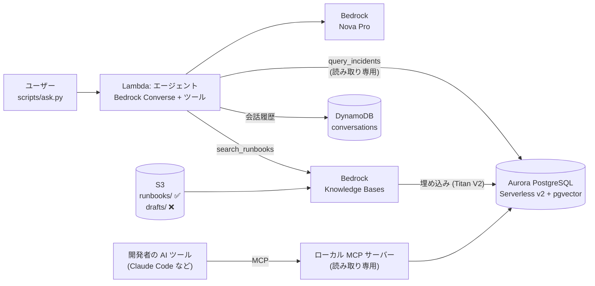

# ops-knowledge-agent-on-aws

運用チーム向けの **「障害対応ナレッジエージェント」** を AWS 上に作る個人検証です。
手順書（非構造データ）と障害履歴（構造データ）の両方を Aurora PostgreSQL に置き、エージェントが質問に応じて使い分けて答えます。

```
$ python3 scripts/ask.py --session demo2 "batch-worker で多い障害の原因と、その対処手順をまとめて"
  🔧 query_incidents: SELECT root_cause, COUNT(*) as incident_count FROM incidents WHERE service = 'batch-worker' GROUP BY root_cause ORDER BY incident_count DESC LIMIT 1
  🔧 search_runbooks: Lambdaのスロットリング

batch-worker で最も多い障害の原因は「Lambdaのスロットリング」です。その対処手順は以下の通りです（参照: lambda-throttling.md）。…
```

テーマは「AI エージェントのデータ層」です。ベクトル検索・最小権限・会話の記憶・AI ツールからの DB 調査（MCP）を、Terraform で一式作って壊せる形にしています。

> AWS マイクロクレデンシャル「AWS Databases for Agentic AI Demonstrated」の取得後に、同じ技術領域を自分で考えた題材で組み直したものです。試験の内容は含みません。

## 構成



| 要素 | 使ったもの | ポイント |
|---|---|---|
| ベクトルストア | Aurora PostgreSQL Serverless v2 + pgvector | HNSW（コサイン）＋ GIN（全文検索）。最小 0 ACU で自動一時停止 |
| 文書検索 | Bedrock Knowledge Bases | Aurora を自前のベクトルストアとして接続。取り込むのは `runbooks/` だけ |
| 構造データ | Aurora の `incidents` テーブルと集計ビュー | エージェントは読み取り専用ユーザーで SELECT のみ |
| エージェント | Lambda（Python）+ Bedrock Converse API | フレームワークなし。ツール 2 つを使い分け |
| 記憶 | DynamoDB | `session_id` + `created_at`、TTL 7 日 |
| DB 調査 | MCP サーバー（Python / stdio） | エージェントと同じ権限で `query` / `explain_query` |
| 接続方式 | RDS Data API | Lambda を VPC に入れない → NAT Gateway 不要、DB の受信ポートを開けない |
| IaC | Terraform | `apply` 1 回で DB の初期化まで完了、`destroy` で全削除 |

設計の理由は [docs/design.md](docs/design.md) にまとめています。

## 試せること

| # | 確認すること | 方法 |
|---|---|---|
| 1 | 質問の内容によって、SQL と文書検索を使い分ける | `scripts/ask.py` |
| 2 | 同じセッションなら「それ」で前の会話を参照できる | `scripts/ask.py --session ...` |
| 3 | 下書き（`drafts/`）は回答に出てこない | 目印の言葉で質問 |
| 4 | 読み取り専用ユーザーは KB のチャンクを読めず、書き込みもできない | RDS クエリエディタ |
| 5 | `<=>` ならインデックスが使われ、`<->` だと全件スキャンになる | `scripts/explain_vector_search.py` |
| 6 | AI ツールから、エージェントと同じ権限で DB を調べられる | MCP サーバー |

## 使い方

**[docs/runbook.md](docs/runbook.md)** に、事前準備・デプロイ・動作確認・削除・公開までの手順をまとめています。

```bash
python3 -m venv .venv && source .venv/bin/activate && pip install -r requirements.txt
cd infra && cp terraform.tfvars.example terraform.tfvars && terraform init && terraform apply && cd ..
python3 scripts/ingest.py
python3 scripts/ask.py "障害が一番多いサービスはどれ？"
cd infra && terraform destroy
```

## 検証結果

2026-11-01 に us-east-1 で確認した結果です（証跡は [evidence/](evidence/)）。

- [x] `terraform apply` で全リソースと DB の初期化が完了した（Aurora PostgreSQL 16.15 Serverless v2）
- [x] 手順書 4 件（10 チャンク）を取り込み、`drafts/` は取り込まれなかった
- [x] SQL・文書検索・両方を使う質問に、根拠付きで回答した
- [x] 会話の続き（記憶）が機能した
- [x] 読み取り専用ユーザーで `permission denied`（KB のチャンク参照・DELETE）を確認した
- [x] `<=>` は HNSW の Index Scan、`<->` は Seq Scan になることを確認した
- [ ] MCP サーバーから `list_tables` / `explain_query` を使った
- [ ] `terraform destroy` で全削除した

詰まったところは [docs/troubleshooting.md](docs/troubleshooting.md) に書いています。

## リポジトリ構成

```
.
├── infra/                 Terraform（Aurora / KB / DynamoDB / Lambda / IAM）
├── lambda/agent/          エージェント本体（handler.py）
├── mcp_server/            DB 調査用の MCP サーバー
├── scripts/               DB 初期化・取り込み・質問・実行計画の比較
├── sql/                   スキーマ・サンプルデータ・確認用クエリ
├── knowledge/             S3 に置く文書（runbooks/ と drafts/）
├── tests/                 AWS を使わない単体テスト
├── docs/                  手順書・設計メモ・トラブルシュート
└── evidence/              スクリーンショット
```

## 注意
- 手順書と障害履歴は、すべて架空のサービスについてのサンプルです
- 費用がかかるので、確認が終わったら `terraform destroy` で削除してください
